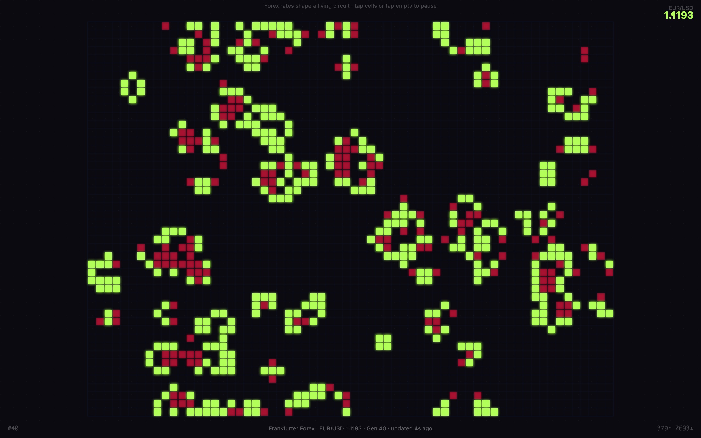

<div align="center">

<h1>flux</h1>

<p><b>Conway's Game of Life, tinted by exchange rates.</b></p>

<p><i>A circuit-board colony of cells that is meant to speed up when currencies move.</i></p>

<h6>


</h6>

<a href="https://parthchandak02.github.io/flux/"><b>Live demo</b></a> ·
<a href="#how-it-works"><b>How it works</b></a> ·
<a href="#run-it"><b>Run it</b></a>

<br><br>

<a href="https://parthchandak02.github.io/flux/"></a>

<sub>Live capture, 23 October 2026.</sub>

</div>

<br>

A 64 × 48 grid runs Conway's B3/S23 rule with wrap-around edges, drawn as glowing square cells
on a dark circuit-board dot grid. It starts from a random 28% fill and 25 warm-up generations.
Every 30 seconds the page asks the [Frankfurter](https://frankfurter.dev) API for EUR/USD,
EUR/GBP and EUR/JPY, and uses the change since the last reading to colour and pace the colony.
No API key is needed. One HTML file, no build step, no libraries.

## How it works

| Data | Drives |
|---|---|
| Direction of the three rates since the last poll (summed) | Colour of every live cell: green when rates rose, red when they fell, pale lime when flat |
| Size of the change since the last poll (volatility) | Speed: one generation every 500 ms when calm, down to every 80 ms when volatile |
| EUR/USD rate | The number in the top-right corner and the status line at the bottom |

Cells that died in the latest step flash dim red for one frame. The bottom corners count
generations and live versus dead cells.

Click or tap a cell to flip it alive or dead. Click outside the grid to pause or resume.

> **Note.** Frankfurter publishes reference rates once per working day, so within one visit the
> rates rarely change and the colony usually stays pale lime at the slowest speed. If the API
> can't be reached, the status line says so and fixed fallback rates (1.0842 USD, 0.8561 GBP,
> 162.43 JPY) are shown. The automaton itself runs either way.

## Run it

```bash
git clone https://github.com/parthchandak02/flux.git
cd flux
python3 -m http.server 8000   # then open http://localhost:8000
```

Opening `index.html` directly also works. Grid size, timings, API URL and colours live in the
`C` and `P` objects at the top of the script.

<details>
<summary><b>The generative series</b></summary>

flux is one of a set of daily generative builds:
[tessellate](https://parthchandak02.github.io/tessellate/) ·
[flora](https://parthchandak02.github.io/flora/) ·
[grow](https://parthchandak02.github.io/grow/) ·
[drift](https://parthchandak02.github.io/drift/) ·
[trace](https://parthchandak02.github.io/trace/) ·
[resonate](https://parthchandak02.github.io/resonate/) ·
[swell](https://parthchandak02.github.io/swell/) ·
[flux](https://parthchandak02.github.io/flux/)

</details>

<br>

<div align="center">
<sub>Built with Canvas 2D in a single HTML file. Data from the Frankfurter API (European Central Bank reference rates).</sub>
</div>
